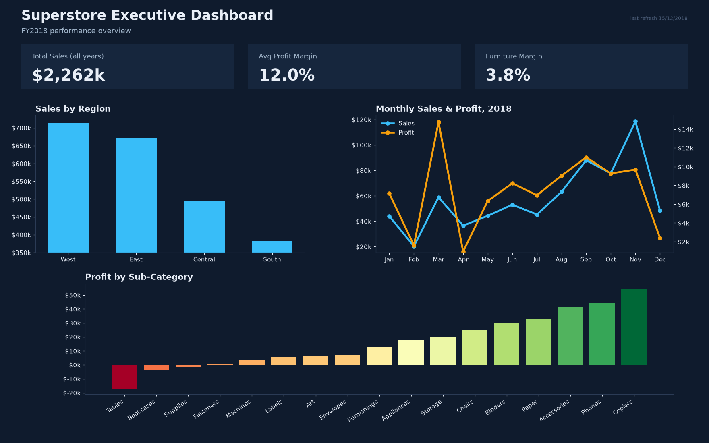
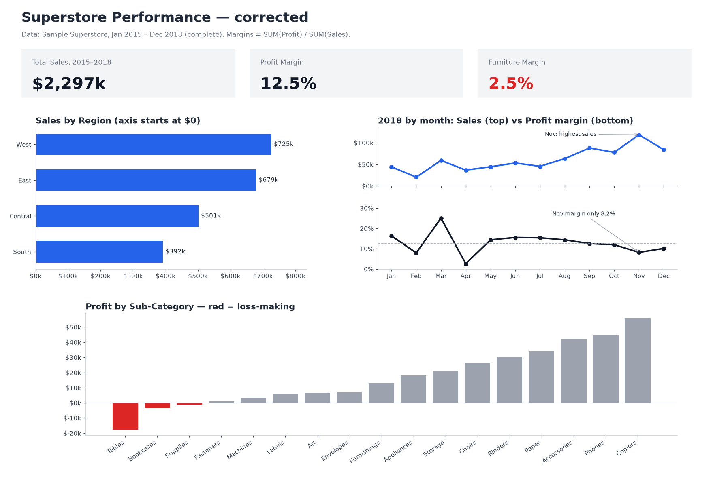

# Dashboard Integrity Audit — Superstore Sales

A polished executive dashboard can hide errors that change the business story. I built one on real data, audited it, and rebuilt it honestly.

**Data:** Tableau's Sample Superstore, 9,994 orders, Jan 2015 – Dec 2018 (`superstore_clean.csv`). `audit.py` removes 806 non-order rows appended to the public file; totals then match the official sample ($2,297,201 sales, $286,397 profit).
**Reader:** a regional sales director planning the new year. **Scenario:** the "before" dashboard was refreshed mid-month (15 Dec 2018).

## Before



## Findings

| # | Trap | What the reader concludes | What is true | Fix |
|---|---|---|---|---|
| 1 | Truncated axis (starts at $350k) | West sells ~11× more than South | West sells 1.87× South ($714k vs $382k) | Start bars at $0, label values |
| 2 | Average of ratios: AVG(Profit/Sales) | Furniture margin 3.8%, overall 12.0% | Furniture 2.4%, overall 12.4% | SUM(Profit) / SUM(Sales) |
| 3 | Dual axis, unsynced scales | Profit tracks sales; November was a great month | November had the highest sales but margin fell to 8.2% | Separate panels; show margin beside sales |
| 4 | Colour centred on the mean, not zero | Six profitable sub-categories look like problems | Only Tables, Bookcases and Supplies lose money | Centre on $0; red only for losses |
| 5 | Incomplete period shown as a full month | December sales crashed 59% | December closed at $83.8k, down 29% (normal) | Drop or flag partial periods |

Also flagged: the header says "FY2018" while the sales tile sums all four years.

## After



## Reproduce

```bash
pip install pandas matplotlib
python audit.py   # downloads the data, writes before.png, after.png and the cleaned CSV
```

The charts and cleaned CSV in this repo are generated by GitHub Actions (`.github/workflows/build.yml`) whenever `audit.py` changes.

Tools: Python (pandas, Matplotlib). A Tableau version is in progress.

— Louis Ampobi · [LinkedIn](https://www.linkedin.com/in/louis-ampobi)
